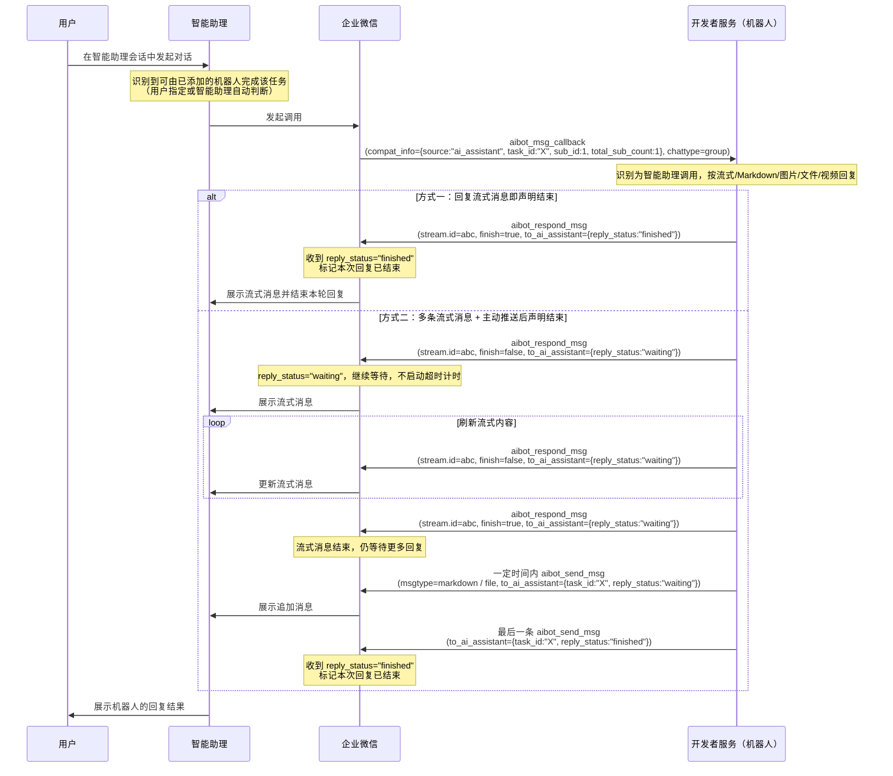

[TOC]

## 概述

智能助理支持调用开发者配置的智能机器人：用户在智能助理会话中发起对话后，智能助理会判断是否需要调用已添加的机器人来完成任务——可以是用户指定使用某个机器人，也可以是智能助理自动识别后调用，由机器人提供具体的服务能力。

智能助理调用智能机器人是**复用已有的智能机器人消息回调通道**：已经接入消息回调通道的智能机器人，在智能助理场景下通常可以直接使用，无需额外改造。如果希望机器人在智能助理场景下获得更好的体验，或需要识别出当前调用来自智能助理，可参考本文档的说明进行接入。

与普通用户消息回调相比，智能助理场景有以下差异：

- 回调中通过 `compat_info` 标识本次消息来自智能助理，同时携带本次调用的唯一 ID 和消息序号，用于智能助理一次调用拆分多条消息时的聚合
- 消息回调支持**文本、图片、文件**三种消息类型，且一次智能助理调用可能被拆分为多条消息回调
- 智能助理的会话会映射为群聊会话，用于区分不同的会话，因此回调中 `chattype` 为 `group` 并携带 `chatid`
- 机器人支持回复**流式消息、Markdown 消息、图片消息、文件消息、视频消息**，不支持模板卡片消息
- 机器人回复多条消息时，企业微信会将本次调用的所有回复**合并为一份结果**返回给智能助理，智能助理侧只会看到一次完整的回复结果
- 开发者可通过 `to_ai_assistant.reply_status` 声明本次回复状态：`"finished"` 表示已全部结束，`"waiting"` 表示后续还有更多回复

> 本文档适用于**长连接**模式。接收 URL 模式参考[智能助理调用智能机器人（接收 URL）](#62776)。

---

## 使用前配置

**1. 在拓展中添加可使用的智能机器人**


**2. 在智能助理会话中选择已添加的智能机器人使用**


---

## 交互流程



---

## 消息回调的特殊标识

智能助理发起的调用，消息回调中会携带 `compat_info` 字段，用于与普通用户消息区分，同时携带本次调用的序号信息。

智能助理调用机器人的消息回调支持以下消息类型：

| 消息类型 | msgtype | 说明 |
|---|---|---|
| 文本消息 | `text` | 参考[文本消息](#62155/文本消息) |
| 图片消息 | `image` | 参考[图片消息](#62155/图片消息) |
| 文件消息 | `file` | 参考[文件消息](#62155/文件消息) |

> **一次智能助理调用可能被拆分为多条消息回调**（例如同时携带文本和文件）。拆分出的多条消息共享同一个 `task_id`，并通过 `sub_id` / `total_sub_count` 标识序号和总数，开发者应据此聚合后再统一处理，详见下方字段说明。

```json
{
    "cmd": "aibot_msg_callback",
    "headers": {
        "req_id": "REQUEST_ID"
    },
    "body": {
        "msgid": "MSGID",
        "aibotid": "AIBOTID",
        "chatid": "CHATID",
        "chattype": "group",
        "from": {
            "userid": "USERID"
        },
        "msgtype": "text",
        "text": {
            "content": "查询一下今天的天气"
        },
        "compat_info": {
            "source": "ai_assistant",
            "from_ai_assistant": {
                "task_id": "CALL_ID",
                "sub_id": 1,
                "total_sub_count": 1
            }
        }
    }
}
```

| 字段 | 类型 | 说明 |
|---|---|---|
| body.compat_info | Object | 本次回调的来源附加信息。有此字段表示本次回调非普通用户消息，开发者可据此与普通用户消息区分处理策略；不返回表示普通用户消息。仅文本消息、图片消息、文件消息三种消息类型会携带 |
| body.compat_info.source | string | 本次回调的来源标识。取值：`ai_assistant` 表示来自智能助理调用（本文档场景）；`channel` 表示来自频道，详见[频道](#62806) |
| body.compat_info.from_ai_assistant | Object | 智能助理调用的附加信息 |
| body.compat_info.from_ai_assistant.task_id | string | 本次智能助理调用的唯一标识。同一次智能助理调用拆分为多条消息时，所有消息共享同一个 `task_id`，开发者可用此字段聚合多条拆分消息 |
| body.compat_info.from_ai_assistant.sub_id | int32 | 当前消息在本次智能助理调用拆分消息中的序号，从 1 开始计数 |
| body.compat_info.from_ai_assistant.total_sub_count | int32 | 本次智能助理调用拆分的消息总条数。建议用「已收到 sub_id 集合大小 == total_sub_count」判断是否收齐，不依赖消息到达顺序 |
| body.chattype | string | 智能助理场景下为 `group` |
| body.chatid | string | 智能助理场景下会返回，用于区分不同的会话 |

> 其余字段与[接收消息回调（长连接）](#62155)一致。

---

## 回复状态字段

智能助理场景下，机器人可在回复时通过 `to_ai_assistant.reply_status` 声明当前的回复状态。

`reply_status` 的取值：

| 取值 | 含义 | 企业微信侧行为 |
|---|---|---|
| `"finished"` | 本次回复已全部结束 | 将本次回复标记为结束，无需等待超时 |
| `"waiting"` | 后续还有回复，继续等待 | 不启动超时计时，等待后续消息到达 |
| 不填（`to_ai_assistant` 不存在） | 未明确声明 | 由企业微信侧自行判断结束时机 |

> **`"waiting"` 的使用场景**：机器人需要回复多条消息时（如先发流式文字，再追加主动推送的文件消息），可在中间每条消息中声明 `"waiting"`，避免任务还在处理中被企业微信侧判断为结束了。

### 支持的回复消息类型

智能助理场景下，机器人支持回复以下消息类型，**不支持模板卡片消息**：

| 消息类型 | msgtype | 说明 |
|---|---|---|
| 流式消息 | `stream` | 参考[流式消息](#62157/流式消息) |
| Markdown 消息 | `markdown` | 参考[Markdown 消息](#62157/markdown-消息) |
| 图片消息 | `image` | 参考[图片消息](#62157/图片消息) |
| 文件消息 | `file` | 参考[文件消息](#62157/文件消息) |
| 视频消息 | `video` | 参考[视频消息](#62157/视频消息) |

> 回复消息的两种方式（[长连接回复](#长连接回复)、[主动推送](#主动推送)）支持的消息类型以各自接口文档为准：[回复消息](#62157)、[主动推送消息](#62158)。

> **多条消息的合并**：机器人在本次调用中回复的所有消息（流式消息的完整内容、后续通过[主动推送](#主动推送)追加的消息等），会由企业微信侧**合并为一份完整结果**再返回给智能助理。智能助理侧看到的是一次完整回复，而非逐条消息。
>
> 因此机器人应在**最后一条**消息上声明 `reply_status="finished"`：声明后企业微信侧即结束本次回复并将合并结果返回给智能助理，之后再到达的消息不会再被计入本次结果。

### 长连接回复

使用 [`aibot_respond_msg`](#62157) 回复消息时，在 `body` 中设置 `to_ai_assistant`：

```json
{
    "cmd": "aibot_respond_msg",
    "headers": {
        "req_id": "REQUEST_ID"
    },
    "body": {
        "msgtype": "stream",
        "stream": {
            "id": "STREAMID",
            "finish": true,
            "content": "广州今日天气：29度，多云，降雨概率60%，建议携带雨具。"
        },
        "to_ai_assistant": {
            "reply_status": "finished"
        }
    }
}
```

| 字段 | 类型 | 必填 | 说明 |
|---|---|---|---|
| body.to_ai_assistant | Object | 否 | 回复给智能助理的信息，仅智能助理场景需要设置 |
| body.to_ai_assistant.reply_status | string | 是（有 to_ai_assistant 时） | 回复状态声明。`"finished"` 表示本次回复已全部结束；`"waiting"` 表示后续还有回复；不填则由企业微信侧自行判断 |

### 主动推送

使用 [`aibot_send_msg`](#62158) 主动推送消息时，在 `body` 中设置 `to_ai_assistant`，其中 `task_id` 填入消息回调中 `compat_info.from_ai_assistant.task_id` 的值，用于精确关联本次智能助理调用：

```json
{
    "cmd": "aibot_send_msg",
    "headers": {
        "req_id": "REQUEST_ID"
    },
    "body": {
        "chatid": "CHATID",
        "chat_type": 2,
        "msgtype": "markdown",
        "markdown": {
            "content": "查询结果已生成"
        },
        "to_ai_assistant": {
            "task_id": "CALL_ID",
            "reply_status": "finished"
        }
    }
}
```

| 字段 | 类型 | 必填 | 说明 |
|---|---|---|---|
| body.to_ai_assistant | Object | 否 | 回复给智能助理的信息，仅智能助理场景需要设置 |
| body.to_ai_assistant.task_id | string | 是（主动推送场景） | 填入消息回调 `compat_info.from_ai_assistant.task_id` 的值，用于关联本次智能助理调用；企业微信侧据此精确定位任务上下文。主动推送时设置了 `to_ai_assistant` 则本字段必填，缺失将返回错误码 `846636` |
| body.to_ai_assistant.reply_status | string | 是（有 to_ai_assistant 时） | 回复状态声明。`"finished"` 表示本次回复已全部结束；`"waiting"` 表示后续还有回复。取值非法将返回错误码 `846634` |