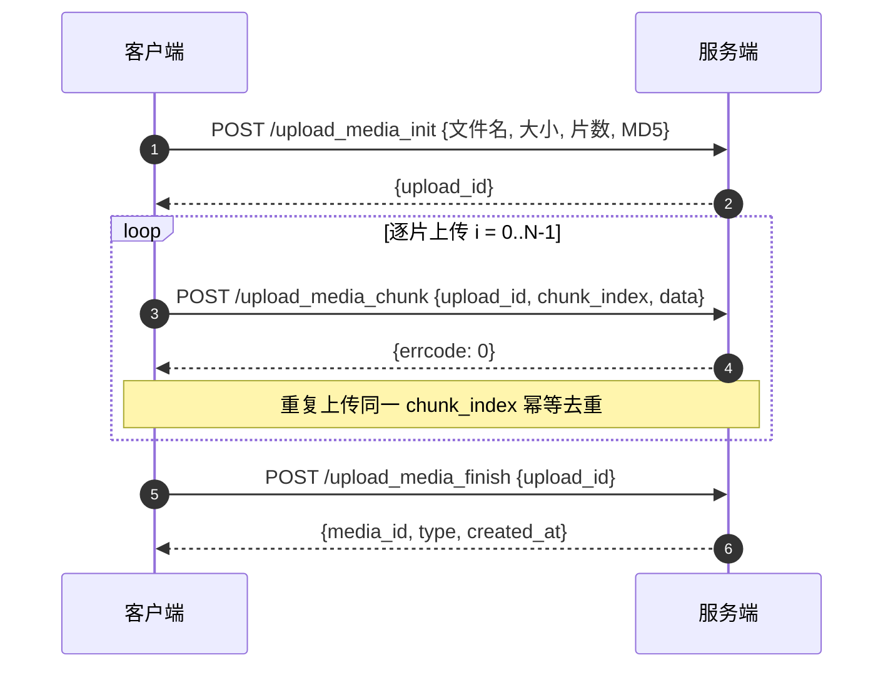

[TOC]
## 概述
通过分片方式上传临时素材（文件、图片、语音、视频），上传完成后获取 `media_id`。可用于发频道帖子/评论时在正文中引用。

上传流程分三步：

1. **初始化上传**：获取 `upload_id`
2. **逐片上传**：按分片发送文件数据
3. **完成上传**：服务端合并分片并返回 `media_id`



**注意事项：**

- 上传会话有效期为 **30 分钟**，超时未完成的上传会话将自动清理
- 单个分片不超过 **4MB**（Base64 编码前），最多支持 **100** 个分片
- 分片可以**乱序上传**，重复上传同一分片会被自动忽略（幂等）
- 服务端按 `chunk_index` 顺序合并分片
- 上传的临时素材有效期为 **3 天**
- 频率限制：单个机器人不超过 30 次/分钟，1000 次/小时

---

## 上传初始化

**请求方式：** POST（**HTTPS**）
**请求地址：** https://qyapi.weixin.qq.com/cgi-bin/aibot/upload_media_init?access_token=ACCESS_TOKEN

```json
{
    "type": "file",
    "filename": "test.pdf",
    "total_size": 2333,
    "total_chunks": 5,
    "md5": "MD5"
}
```

**参数说明：**

| 参数 | 是否必须 | 类型 | 说明 |
|------|---------|------|------|
| access_token | 是 | String | [机器人调用接口凭证](#62616) |
| type | 是 | String | 文件类型：`file`（普通文件）/ `image`（图片）/ `voice`（语音）/ `video`（视频） |
| filename | 是 | String | 文件名，不超过 256 字节 |
| total_size | 是 | Integer | 文件总大小（字节）。图片不超过 10MB，语音不超过 2MB，视频不超过 10MB，普通文件不超过 20MB |
| total_chunks | 是 | Integer | 分片数量，不超过 100 个 |
| md5 | 否 | String | 文件 MD5，服务端合并后校验完整性 |

>图片支持 png、jpg/jpeg、gif 格式；语音支持 amr 格式；视频支持 mp4 格式。

**返回结果：**

```json
{
    "errcode": 0,
    "errmsg": "ok",
    "upload_id": "UPLOAD_ID"
}
```

**参数说明：**

| 参数 | 类型 | 说明 |
|------|------|------|
| errcode | Integer | 错误码 |
| errmsg | String | 错误码说明 |
| upload_id | String | 本次上传操作的 ID，用于后续分片上传和完成上传 |

---

## 上传分片

**请求方式：** POST（**HTTPS**）
**请求地址：** https://qyapi.weixin.qq.com/cgi-bin/aibot/upload_media_chunk?access_token=ACCESS_TOKEN

```json
{
    "upload_id": "UPLOAD_ID",
    "chunk_index": 0,
    "base64_data": "BASE64_ENCODED_DATA"
}
```

**参数说明：**

| 参数 | 是否必须 | 类型 | 说明 |
|------|---------|------|------|
| access_token | 是 | String | [机器人调用接口凭证](#62616) |
| upload_id | 是 | String | 初始化时返回的 `upload_id` |
| chunk_index | 是 | Integer | 分片序号，从 0 开始 |
| base64_data | 是 | String | 分片内容经过 Base64 编码后的数据，编码前单个分片不超过 512KB |

**返回结果：**

```json
{
    "errcode": 0,
    "errmsg": "ok"
}
```

**参数说明：**

| 参数 | 类型 | 说明 |
|------|------|------|
| errcode | Integer | 错误码 |
| errmsg | String | 错误码说明 |

---

## 完成上传

所有分片上传完成后，调用此接口通知服务端合并分片。服务端校验所有分片是否齐全、MD5 是否匹配，然后返回 `media_id`。

**请求方式：** POST（**HTTPS**）
**请求地址：** https://qyapi.weixin.qq.com/cgi-bin/aibot/upload_media_finish?access_token=ACCESS_TOKEN

```json
{
    "upload_id": "UPLOAD_ID"
}
```

**参数说明：**

| 参数 | 是否必须 | 类型 | 说明 |
|------|---------|------|------|
| access_token | 是 | String | [机器人调用接口凭证](#62616) |
| upload_id | 是 | String | 初始化时返回的 `upload_id` |

**返回结果：**

```json
{
    "errcode": 0,
    "errmsg": "ok",
    "type": "file",
    "media_id": "MEDIA_ID",
    "created_at": 1700000000
}
```

**参数说明：**

| 参数 | 类型 | 说明 |
|------|------|------|
| errcode | Integer | 错误码 |
| errmsg | String | 错误码说明 |
| type | String | 文件类型 |
| media_id | String | 媒体文件唯一标识，**3 天内有效**，用于发帖/评论时在 `inline_file_list` 中引用 |
| created_at | Integer | 媒体文件上传时间戳 |

---

## 典型调用流程

```
第一步：初始化上传
  POST /upload_media_init  {type: "file", filename: "report.pdf", total_size: 102400, total_chunks: 2}
  → {upload_id: "U1"}

第二步：逐片上传（可乱序）
  POST /upload_media_chunk  multipart: upload_id=U1, chunk_index=0, data=<binary>
  → {errcode: 0}

  POST /upload_media_chunk  multipart: upload_id=U1, chunk_index=1, data=<binary>
  → {errcode: 0}

第三步：完成上传
  POST /upload_media_finish  {upload_id: "U1"}
  → {media_id: "M1", type: "file", created_at: 1700000000}

```
